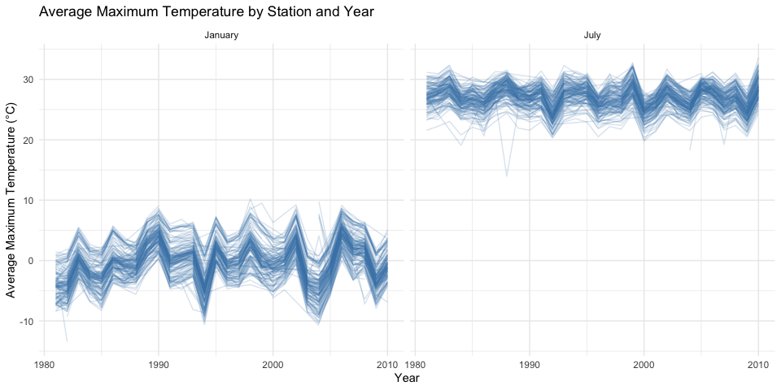
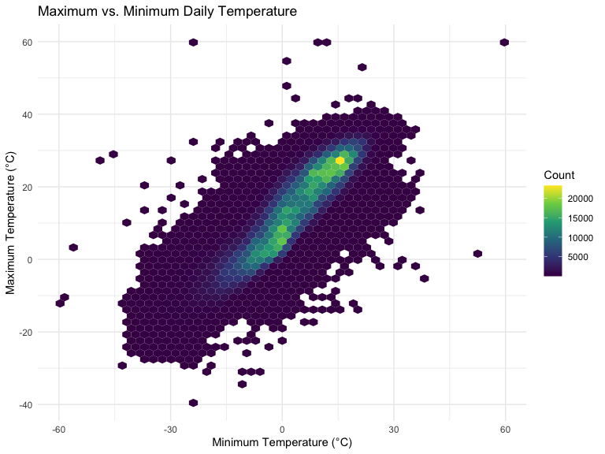
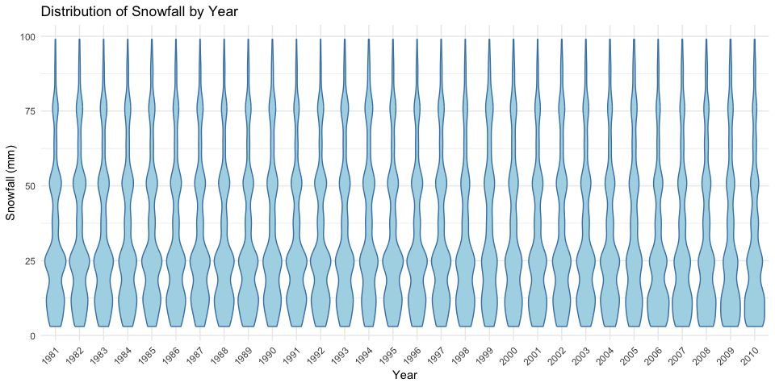
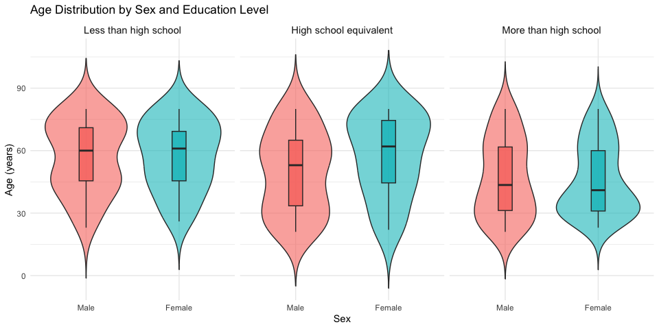
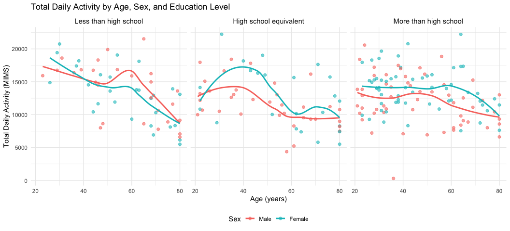
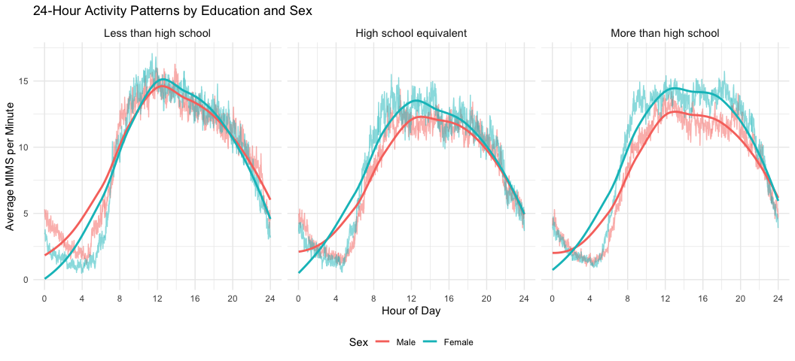
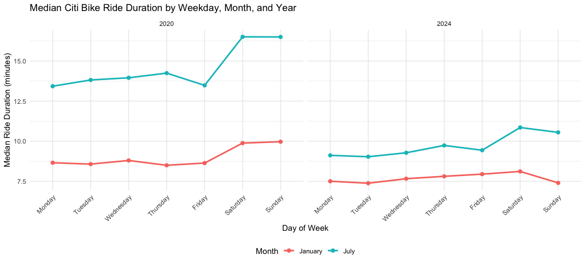
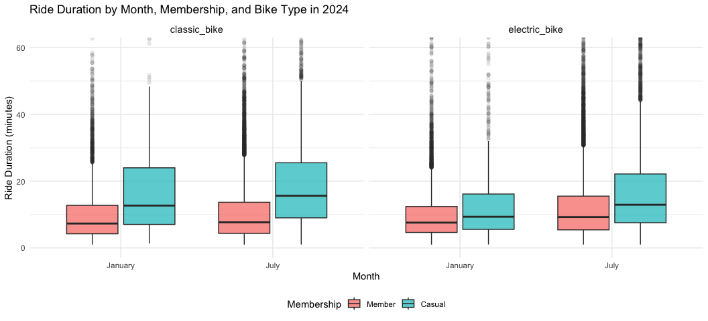

P8105 Homework 3
================
Cecilia Zhu

# Problem 1

## Load and examine the data

``` r
data("ny_noaa")

dim(ny_noaa)
```

    ## [1] 2595176       7

``` r
names(ny_noaa)
```

    ## [1] "id"   "date" "prcp" "snow" "snwd" "tmax" "tmin"

``` r
head(ny_noaa)
```

    ## # A tibble: 6 × 7
    ##   id          date        prcp  snow  snwd tmax  tmin 
    ##   <chr>       <date>     <int> <int> <int> <chr> <chr>
    ## 1 US1NYAB0001 2007-11-01    NA    NA    NA <NA>  <NA> 
    ## 2 US1NYAB0001 2007-11-02    NA    NA    NA <NA>  <NA> 
    ## 3 US1NYAB0001 2007-11-03    NA    NA    NA <NA>  <NA> 
    ## 4 US1NYAB0001 2007-11-04    NA    NA    NA <NA>  <NA> 
    ## 5 US1NYAB0001 2007-11-05    NA    NA    NA <NA>  <NA> 
    ## 6 US1NYAB0001 2007-11-06    NA    NA    NA <NA>  <NA>

## Dataset structure and missing values

``` r
glimpse(ny_noaa)
```

    ## Rows: 2,595,176
    ## Columns: 7
    ## $ id   <chr> "US1NYAB0001", "US1NYAB0001", "US1NYAB0001", "US1NYAB0001", "US1N…
    ## $ date <date> 2007-11-01, 2007-11-02, 2007-11-03, 2007-11-04, 2007-11-05, 2007…
    ## $ prcp <int> NA, NA, NA, NA, NA, NA, NA, NA, NA, NA, NA, NA, NA, NA, NA, NA, 3…
    ## $ snow <int> NA, NA, NA, NA, NA, NA, NA, NA, NA, NA, NA, NA, NA, NA, NA, NA, 3…
    ## $ snwd <int> NA, NA, NA, NA, NA, NA, NA, NA, NA, NA, NA, NA, NA, NA, NA, NA, 0…
    ## $ tmax <chr> NA, NA, NA, NA, NA, NA, NA, NA, NA, NA, NA, NA, NA, NA, NA, NA, N…
    ## $ tmin <chr> NA, NA, NA, NA, NA, NA, NA, NA, NA, NA, NA, NA, NA, NA, NA, NA, N…

``` r
ny_noaa |>
  summarize(
    across(
      everything(),
      ~ sum(is.na(.x))
    )
  )
```

    ## # A tibble: 1 × 7
    ##      id  date   prcp   snow   snwd    tmax    tmin
    ##   <int> <int>  <int>  <int>  <int>   <int>   <int>
    ## 1     0     0 145838 381221 591786 1134358 1134420

The `ny_noaa` dataset contains 2,595,176 observations and 7 variables,
representing daily weather measurements collected at weather stations in
New York State. Each observation corresponds to a particular station and
date.

The dataset includes station identifiers (`id`), observation dates
(`date`), precipitation (`prcp`), snowfall (`snow`), snow depth
(`snwd`), maximum daily temperature (`tmax`), and minimum daily
temperature (`tmin`). The data contain missing values in several weather
measurements, which must be considered when summarizing and visualizing
the dataset.

## Data cleaning

``` r
noaa_clean = ny_noaa |>
  mutate(
    year = lubridate::year(date),
    month = lubridate::month(date),
    day = lubridate::day(date),
    tmax = as.numeric(tmax) / 10,
    tmin = as.numeric(tmin) / 10,
    prcp = prcp / 10
  ) |>
  relocate(year, month, day, .after = date)

glimpse(noaa_clean)
```

    ## Rows: 2,595,176
    ## Columns: 10
    ## $ id    <chr> "US1NYAB0001", "US1NYAB0001", "US1NYAB0001", "US1NYAB0001", "US1…
    ## $ date  <date> 2007-11-01, 2007-11-02, 2007-11-03, 2007-11-04, 2007-11-05, 200…
    ## $ year  <dbl> 2007, 2007, 2007, 2007, 2007, 2007, 2007, 2007, 2007, 2007, 2007…
    ## $ month <dbl> 11, 11, 11, 11, 11, 11, 11, 11, 11, 11, 11, 11, 11, 11, 11, 11, …
    ## $ day   <int> 1, 2, 3, 4, 5, 6, 7, 8, 9, 10, 11, 12, 13, 14, 15, 16, 17, 18, 1…
    ## $ prcp  <dbl> NA, NA, NA, NA, NA, NA, NA, NA, NA, NA, NA, NA, NA, NA, NA, NA, …
    ## $ snow  <int> NA, NA, NA, NA, NA, NA, NA, NA, NA, NA, NA, NA, NA, NA, NA, NA, …
    ## $ snwd  <int> NA, NA, NA, NA, NA, NA, NA, NA, NA, NA, NA, NA, NA, NA, NA, NA, …
    ## $ tmax  <dbl> NA, NA, NA, NA, NA, NA, NA, NA, NA, NA, NA, NA, NA, NA, NA, NA, …
    ## $ tmin  <dbl> NA, NA, NA, NA, NA, NA, NA, NA, NA, NA, NA, NA, NA, NA, NA, NA, …

## Most common snowfall values

``` r
noaa_clean |>
  count(snow, sort = TRUE) |>
  head(10) |>
  knitr::kable(
    col.names = c("Snowfall (mm)", "Number of observations"),
    caption = "Ten Most Common Snowfall Values"
  )
```

| Snowfall (mm) | Number of observations |
|--------------:|-----------------------:|
|             0 |                2008508 |
|            NA |                 381221 |
|            25 |                  31022 |
|            13 |                  23095 |
|            51 |                  18274 |
|            76 |                  10173 |
|             8 |                   9962 |
|             5 |                   9748 |
|            38 |                   9197 |
|             3 |                   8790 |

Ten Most Common Snowfall Values

The most commonly observed snowfall value is 0 mm (2,008,508
observations), followed by missing values (381,221 observations) and 25
mm (31,022 observations). The high frequency of 0 mm is expected because
snowfall is seasonal in New York, and most days do not experience snow.
The relatively large number of missing values suggests incomplete
snowfall reporting. The frequent occurrence of 25 mm may reflect the
reporting and rounding of snowfall measurements, as 25 mm is
approximately one inch.

## Average maximum temperature in January and July

``` r
noaa_clean |>
  filter(month %in% c(1, 7)) |>
  group_by(id, year, month) |>
  summarize(
    mean_tmax = mean(tmax, na.rm = TRUE),
    .groups = "drop"
  ) |>
  mutate(
    month = factor(
      month,
      levels = c(1, 7),
      labels = c("January", "July")
    )
  ) |>
  ggplot(aes(x = year, y = mean_tmax, group = id)) +
  geom_line(alpha = 0.2, color = "steelblue") +
  facet_grid(. ~ month) +
  labs(
    title = "Average Maximum Temperature by Station and Year",
    x = "Year",
    y = "Average Maximum Temperature (°C)"
  ) +
  theme_minimal()
```

<!-- --> The
plot shows a clear seasonal difference in average maximum temperatures
between January and July. January temperatures are generally much lower,
with most station averages ranging from approximately -5°C to 5°C, while
July temperatures are typically between 25°C and 30°C.

Temperature patterns across stations appear relatively consistent, with
many stations showing similar year-to-year fluctuations. This suggests
that regional weather patterns influence temperatures across New York
State. Some unusually low temperatures are visible, particularly in
July, which may reflect unusual weather conditions, differences in
station locations, or potential measurement anomalies. There is no clear
long-term trend that can be confidently established from this plot
alone.

## Maximum vs. minimum temperature

``` r
noaa_clean |>
  filter(!is.na(tmax), !is.na(tmin)) |>
  ggplot(aes(x = tmin, y = tmax)) +
  geom_hex(bins = 50) +
  scale_fill_viridis_c() +
  labs(
    title = "Maximum vs. Minimum Daily Temperature",
    x = "Minimum Temperature (°C)",
    y = "Maximum Temperature (°C)",
    fill = "Count"
  ) +
  theme_minimal()
```

<!-- --> The
hexbin plot shows a strong positive relationship between daily minimum
and maximum temperatures. Days with higher minimum temperatures
generally also have higher maximum temperatures. Most observations are
concentrated along a diagonal band, indicating a relatively consistent
relationship between the two temperature measurements.

A few observations fall far outside the main cluster, suggesting
unusually extreme temperatures or possible measurement errors. The
hexbin visualization is particularly useful for this large dataset
because it reveals observation density without the substantial
overplotting associated with a traditional scatterplot. \## Snowfall
distribution by year

``` r
noaa_clean |>
  filter(snow > 0, snow < 100) |>
  ggplot(aes(x = factor(year), y = snow)) +
  geom_violin(fill = "lightblue", color = "steelblue") +
  labs(
    title = "Distribution of Snowfall by Year",
    x = "Year",
    y = "Snowfall (mm)"
  ) +
  theme_minimal() +
  theme(
    axis.text.x = element_text(angle = 45, hjust = 1)
  )
```

<!-- -->
The violin plots show that snowfall distributions are relatively
consistent across years. Observations are concentrated around several
distinct values, particularly approximately 25 mm, 50 mm, and 75 mm,
rather than being distributed uniformly.

These concentrations may reflect the rounding or conversion of snowfall
measurements from inches to millimeters. Although some variation is
visible across years, there is no obvious long-term shift in the
distribution of snowfall amounts between 1981 and 2010. This plot
describes the distribution of individual snowfall measurements and does
not directly indicate changes in total annual snowfall.

# Problem 2

## Load NHANES data

``` r
nhanes_covar = read_csv(
  "data/nhanes_covar.csv",
  skip = 4,
  show_col_types = FALSE
)

nhanes_accel = read_csv(
  "data/nhanes_accel.csv",
  show_col_types = FALSE
)

dim(nhanes_covar)
```

    ## [1] 250   5

``` r
dim(nhanes_accel)
```

    ## [1]  250 1441

``` r
names(nhanes_covar)
```

    ## [1] "SEQN"      "sex"       "age"       "BMI"       "education"

``` r
names(nhanes_accel)
```

    ##    [1] "SEQN"    "min1"    "min2"    "min3"    "min4"    "min5"    "min6"   
    ##    [8] "min7"    "min8"    "min9"    "min10"   "min11"   "min12"   "min13"  
    ##   [15] "min14"   "min15"   "min16"   "min17"   "min18"   "min19"   "min20"  
    ##   [22] "min21"   "min22"   "min23"   "min24"   "min25"   "min26"   "min27"  
    ##   [29] "min28"   "min29"   "min30"   "min31"   "min32"   "min33"   "min34"  
    ##   [36] "min35"   "min36"   "min37"   "min38"   "min39"   "min40"   "min41"  
    ##   [43] "min42"   "min43"   "min44"   "min45"   "min46"   "min47"   "min48"  
    ##   [50] "min49"   "min50"   "min51"   "min52"   "min53"   "min54"   "min55"  
    ##   [57] "min56"   "min57"   "min58"   "min59"   "min60"   "min61"   "min62"  
    ##   [64] "min63"   "min64"   "min65"   "min66"   "min67"   "min68"   "min69"  
    ##   [71] "min70"   "min71"   "min72"   "min73"   "min74"   "min75"   "min76"  
    ##   [78] "min77"   "min78"   "min79"   "min80"   "min81"   "min82"   "min83"  
    ##   [85] "min84"   "min85"   "min86"   "min87"   "min88"   "min89"   "min90"  
    ##   [92] "min91"   "min92"   "min93"   "min94"   "min95"   "min96"   "min97"  
    ##   [99] "min98"   "min99"   "min100"  "min101"  "min102"  "min103"  "min104" 
    ##  [106] "min105"  "min106"  "min107"  "min108"  "min109"  "min110"  "min111" 
    ##  [113] "min112"  "min113"  "min114"  "min115"  "min116"  "min117"  "min118" 
    ##  [120] "min119"  "min120"  "min121"  "min122"  "min123"  "min124"  "min125" 
    ##  [127] "min126"  "min127"  "min128"  "min129"  "min130"  "min131"  "min132" 
    ##  [134] "min133"  "min134"  "min135"  "min136"  "min137"  "min138"  "min139" 
    ##  [141] "min140"  "min141"  "min142"  "min143"  "min144"  "min145"  "min146" 
    ##  [148] "min147"  "min148"  "min149"  "min150"  "min151"  "min152"  "min153" 
    ##  [155] "min154"  "min155"  "min156"  "min157"  "min158"  "min159"  "min160" 
    ##  [162] "min161"  "min162"  "min163"  "min164"  "min165"  "min166"  "min167" 
    ##  [169] "min168"  "min169"  "min170"  "min171"  "min172"  "min173"  "min174" 
    ##  [176] "min175"  "min176"  "min177"  "min178"  "min179"  "min180"  "min181" 
    ##  [183] "min182"  "min183"  "min184"  "min185"  "min186"  "min187"  "min188" 
    ##  [190] "min189"  "min190"  "min191"  "min192"  "min193"  "min194"  "min195" 
    ##  [197] "min196"  "min197"  "min198"  "min199"  "min200"  "min201"  "min202" 
    ##  [204] "min203"  "min204"  "min205"  "min206"  "min207"  "min208"  "min209" 
    ##  [211] "min210"  "min211"  "min212"  "min213"  "min214"  "min215"  "min216" 
    ##  [218] "min217"  "min218"  "min219"  "min220"  "min221"  "min222"  "min223" 
    ##  [225] "min224"  "min225"  "min226"  "min227"  "min228"  "min229"  "min230" 
    ##  [232] "min231"  "min232"  "min233"  "min234"  "min235"  "min236"  "min237" 
    ##  [239] "min238"  "min239"  "min240"  "min241"  "min242"  "min243"  "min244" 
    ##  [246] "min245"  "min246"  "min247"  "min248"  "min249"  "min250"  "min251" 
    ##  [253] "min252"  "min253"  "min254"  "min255"  "min256"  "min257"  "min258" 
    ##  [260] "min259"  "min260"  "min261"  "min262"  "min263"  "min264"  "min265" 
    ##  [267] "min266"  "min267"  "min268"  "min269"  "min270"  "min271"  "min272" 
    ##  [274] "min273"  "min274"  "min275"  "min276"  "min277"  "min278"  "min279" 
    ##  [281] "min280"  "min281"  "min282"  "min283"  "min284"  "min285"  "min286" 
    ##  [288] "min287"  "min288"  "min289"  "min290"  "min291"  "min292"  "min293" 
    ##  [295] "min294"  "min295"  "min296"  "min297"  "min298"  "min299"  "min300" 
    ##  [302] "min301"  "min302"  "min303"  "min304"  "min305"  "min306"  "min307" 
    ##  [309] "min308"  "min309"  "min310"  "min311"  "min312"  "min313"  "min314" 
    ##  [316] "min315"  "min316"  "min317"  "min318"  "min319"  "min320"  "min321" 
    ##  [323] "min322"  "min323"  "min324"  "min325"  "min326"  "min327"  "min328" 
    ##  [330] "min329"  "min330"  "min331"  "min332"  "min333"  "min334"  "min335" 
    ##  [337] "min336"  "min337"  "min338"  "min339"  "min340"  "min341"  "min342" 
    ##  [344] "min343"  "min344"  "min345"  "min346"  "min347"  "min348"  "min349" 
    ##  [351] "min350"  "min351"  "min352"  "min353"  "min354"  "min355"  "min356" 
    ##  [358] "min357"  "min358"  "min359"  "min360"  "min361"  "min362"  "min363" 
    ##  [365] "min364"  "min365"  "min366"  "min367"  "min368"  "min369"  "min370" 
    ##  [372] "min371"  "min372"  "min373"  "min374"  "min375"  "min376"  "min377" 
    ##  [379] "min378"  "min379"  "min380"  "min381"  "min382"  "min383"  "min384" 
    ##  [386] "min385"  "min386"  "min387"  "min388"  "min389"  "min390"  "min391" 
    ##  [393] "min392"  "min393"  "min394"  "min395"  "min396"  "min397"  "min398" 
    ##  [400] "min399"  "min400"  "min401"  "min402"  "min403"  "min404"  "min405" 
    ##  [407] "min406"  "min407"  "min408"  "min409"  "min410"  "min411"  "min412" 
    ##  [414] "min413"  "min414"  "min415"  "min416"  "min417"  "min418"  "min419" 
    ##  [421] "min420"  "min421"  "min422"  "min423"  "min424"  "min425"  "min426" 
    ##  [428] "min427"  "min428"  "min429"  "min430"  "min431"  "min432"  "min433" 
    ##  [435] "min434"  "min435"  "min436"  "min437"  "min438"  "min439"  "min440" 
    ##  [442] "min441"  "min442"  "min443"  "min444"  "min445"  "min446"  "min447" 
    ##  [449] "min448"  "min449"  "min450"  "min451"  "min452"  "min453"  "min454" 
    ##  [456] "min455"  "min456"  "min457"  "min458"  "min459"  "min460"  "min461" 
    ##  [463] "min462"  "min463"  "min464"  "min465"  "min466"  "min467"  "min468" 
    ##  [470] "min469"  "min470"  "min471"  "min472"  "min473"  "min474"  "min475" 
    ##  [477] "min476"  "min477"  "min478"  "min479"  "min480"  "min481"  "min482" 
    ##  [484] "min483"  "min484"  "min485"  "min486"  "min487"  "min488"  "min489" 
    ##  [491] "min490"  "min491"  "min492"  "min493"  "min494"  "min495"  "min496" 
    ##  [498] "min497"  "min498"  "min499"  "min500"  "min501"  "min502"  "min503" 
    ##  [505] "min504"  "min505"  "min506"  "min507"  "min508"  "min509"  "min510" 
    ##  [512] "min511"  "min512"  "min513"  "min514"  "min515"  "min516"  "min517" 
    ##  [519] "min518"  "min519"  "min520"  "min521"  "min522"  "min523"  "min524" 
    ##  [526] "min525"  "min526"  "min527"  "min528"  "min529"  "min530"  "min531" 
    ##  [533] "min532"  "min533"  "min534"  "min535"  "min536"  "min537"  "min538" 
    ##  [540] "min539"  "min540"  "min541"  "min542"  "min543"  "min544"  "min545" 
    ##  [547] "min546"  "min547"  "min548"  "min549"  "min550"  "min551"  "min552" 
    ##  [554] "min553"  "min554"  "min555"  "min556"  "min557"  "min558"  "min559" 
    ##  [561] "min560"  "min561"  "min562"  "min563"  "min564"  "min565"  "min566" 
    ##  [568] "min567"  "min568"  "min569"  "min570"  "min571"  "min572"  "min573" 
    ##  [575] "min574"  "min575"  "min576"  "min577"  "min578"  "min579"  "min580" 
    ##  [582] "min581"  "min582"  "min583"  "min584"  "min585"  "min586"  "min587" 
    ##  [589] "min588"  "min589"  "min590"  "min591"  "min592"  "min593"  "min594" 
    ##  [596] "min595"  "min596"  "min597"  "min598"  "min599"  "min600"  "min601" 
    ##  [603] "min602"  "min603"  "min604"  "min605"  "min606"  "min607"  "min608" 
    ##  [610] "min609"  "min610"  "min611"  "min612"  "min613"  "min614"  "min615" 
    ##  [617] "min616"  "min617"  "min618"  "min619"  "min620"  "min621"  "min622" 
    ##  [624] "min623"  "min624"  "min625"  "min626"  "min627"  "min628"  "min629" 
    ##  [631] "min630"  "min631"  "min632"  "min633"  "min634"  "min635"  "min636" 
    ##  [638] "min637"  "min638"  "min639"  "min640"  "min641"  "min642"  "min643" 
    ##  [645] "min644"  "min645"  "min646"  "min647"  "min648"  "min649"  "min650" 
    ##  [652] "min651"  "min652"  "min653"  "min654"  "min655"  "min656"  "min657" 
    ##  [659] "min658"  "min659"  "min660"  "min661"  "min662"  "min663"  "min664" 
    ##  [666] "min665"  "min666"  "min667"  "min668"  "min669"  "min670"  "min671" 
    ##  [673] "min672"  "min673"  "min674"  "min675"  "min676"  "min677"  "min678" 
    ##  [680] "min679"  "min680"  "min681"  "min682"  "min683"  "min684"  "min685" 
    ##  [687] "min686"  "min687"  "min688"  "min689"  "min690"  "min691"  "min692" 
    ##  [694] "min693"  "min694"  "min695"  "min696"  "min697"  "min698"  "min699" 
    ##  [701] "min700"  "min701"  "min702"  "min703"  "min704"  "min705"  "min706" 
    ##  [708] "min707"  "min708"  "min709"  "min710"  "min711"  "min712"  "min713" 
    ##  [715] "min714"  "min715"  "min716"  "min717"  "min718"  "min719"  "min720" 
    ##  [722] "min721"  "min722"  "min723"  "min724"  "min725"  "min726"  "min727" 
    ##  [729] "min728"  "min729"  "min730"  "min731"  "min732"  "min733"  "min734" 
    ##  [736] "min735"  "min736"  "min737"  "min738"  "min739"  "min740"  "min741" 
    ##  [743] "min742"  "min743"  "min744"  "min745"  "min746"  "min747"  "min748" 
    ##  [750] "min749"  "min750"  "min751"  "min752"  "min753"  "min754"  "min755" 
    ##  [757] "min756"  "min757"  "min758"  "min759"  "min760"  "min761"  "min762" 
    ##  [764] "min763"  "min764"  "min765"  "min766"  "min767"  "min768"  "min769" 
    ##  [771] "min770"  "min771"  "min772"  "min773"  "min774"  "min775"  "min776" 
    ##  [778] "min777"  "min778"  "min779"  "min780"  "min781"  "min782"  "min783" 
    ##  [785] "min784"  "min785"  "min786"  "min787"  "min788"  "min789"  "min790" 
    ##  [792] "min791"  "min792"  "min793"  "min794"  "min795"  "min796"  "min797" 
    ##  [799] "min798"  "min799"  "min800"  "min801"  "min802"  "min803"  "min804" 
    ##  [806] "min805"  "min806"  "min807"  "min808"  "min809"  "min810"  "min811" 
    ##  [813] "min812"  "min813"  "min814"  "min815"  "min816"  "min817"  "min818" 
    ##  [820] "min819"  "min820"  "min821"  "min822"  "min823"  "min824"  "min825" 
    ##  [827] "min826"  "min827"  "min828"  "min829"  "min830"  "min831"  "min832" 
    ##  [834] "min833"  "min834"  "min835"  "min836"  "min837"  "min838"  "min839" 
    ##  [841] "min840"  "min841"  "min842"  "min843"  "min844"  "min845"  "min846" 
    ##  [848] "min847"  "min848"  "min849"  "min850"  "min851"  "min852"  "min853" 
    ##  [855] "min854"  "min855"  "min856"  "min857"  "min858"  "min859"  "min860" 
    ##  [862] "min861"  "min862"  "min863"  "min864"  "min865"  "min866"  "min867" 
    ##  [869] "min868"  "min869"  "min870"  "min871"  "min872"  "min873"  "min874" 
    ##  [876] "min875"  "min876"  "min877"  "min878"  "min879"  "min880"  "min881" 
    ##  [883] "min882"  "min883"  "min884"  "min885"  "min886"  "min887"  "min888" 
    ##  [890] "min889"  "min890"  "min891"  "min892"  "min893"  "min894"  "min895" 
    ##  [897] "min896"  "min897"  "min898"  "min899"  "min900"  "min901"  "min902" 
    ##  [904] "min903"  "min904"  "min905"  "min906"  "min907"  "min908"  "min909" 
    ##  [911] "min910"  "min911"  "min912"  "min913"  "min914"  "min915"  "min916" 
    ##  [918] "min917"  "min918"  "min919"  "min920"  "min921"  "min922"  "min923" 
    ##  [925] "min924"  "min925"  "min926"  "min927"  "min928"  "min929"  "min930" 
    ##  [932] "min931"  "min932"  "min933"  "min934"  "min935"  "min936"  "min937" 
    ##  [939] "min938"  "min939"  "min940"  "min941"  "min942"  "min943"  "min944" 
    ##  [946] "min945"  "min946"  "min947"  "min948"  "min949"  "min950"  "min951" 
    ##  [953] "min952"  "min953"  "min954"  "min955"  "min956"  "min957"  "min958" 
    ##  [960] "min959"  "min960"  "min961"  "min962"  "min963"  "min964"  "min965" 
    ##  [967] "min966"  "min967"  "min968"  "min969"  "min970"  "min971"  "min972" 
    ##  [974] "min973"  "min974"  "min975"  "min976"  "min977"  "min978"  "min979" 
    ##  [981] "min980"  "min981"  "min982"  "min983"  "min984"  "min985"  "min986" 
    ##  [988] "min987"  "min988"  "min989"  "min990"  "min991"  "min992"  "min993" 
    ##  [995] "min994"  "min995"  "min996"  "min997"  "min998"  "min999"  "min1000"
    ## [1002] "min1001" "min1002" "min1003" "min1004" "min1005" "min1006" "min1007"
    ## [1009] "min1008" "min1009" "min1010" "min1011" "min1012" "min1013" "min1014"
    ## [1016] "min1015" "min1016" "min1017" "min1018" "min1019" "min1020" "min1021"
    ## [1023] "min1022" "min1023" "min1024" "min1025" "min1026" "min1027" "min1028"
    ## [1030] "min1029" "min1030" "min1031" "min1032" "min1033" "min1034" "min1035"
    ## [1037] "min1036" "min1037" "min1038" "min1039" "min1040" "min1041" "min1042"
    ## [1044] "min1043" "min1044" "min1045" "min1046" "min1047" "min1048" "min1049"
    ## [1051] "min1050" "min1051" "min1052" "min1053" "min1054" "min1055" "min1056"
    ## [1058] "min1057" "min1058" "min1059" "min1060" "min1061" "min1062" "min1063"
    ## [1065] "min1064" "min1065" "min1066" "min1067" "min1068" "min1069" "min1070"
    ## [1072] "min1071" "min1072" "min1073" "min1074" "min1075" "min1076" "min1077"
    ## [1079] "min1078" "min1079" "min1080" "min1081" "min1082" "min1083" "min1084"
    ## [1086] "min1085" "min1086" "min1087" "min1088" "min1089" "min1090" "min1091"
    ## [1093] "min1092" "min1093" "min1094" "min1095" "min1096" "min1097" "min1098"
    ## [1100] "min1099" "min1100" "min1101" "min1102" "min1103" "min1104" "min1105"
    ## [1107] "min1106" "min1107" "min1108" "min1109" "min1110" "min1111" "min1112"
    ## [1114] "min1113" "min1114" "min1115" "min1116" "min1117" "min1118" "min1119"
    ## [1121] "min1120" "min1121" "min1122" "min1123" "min1124" "min1125" "min1126"
    ## [1128] "min1127" "min1128" "min1129" "min1130" "min1131" "min1132" "min1133"
    ## [1135] "min1134" "min1135" "min1136" "min1137" "min1138" "min1139" "min1140"
    ## [1142] "min1141" "min1142" "min1143" "min1144" "min1145" "min1146" "min1147"
    ## [1149] "min1148" "min1149" "min1150" "min1151" "min1152" "min1153" "min1154"
    ## [1156] "min1155" "min1156" "min1157" "min1158" "min1159" "min1160" "min1161"
    ## [1163] "min1162" "min1163" "min1164" "min1165" "min1166" "min1167" "min1168"
    ## [1170] "min1169" "min1170" "min1171" "min1172" "min1173" "min1174" "min1175"
    ## [1177] "min1176" "min1177" "min1178" "min1179" "min1180" "min1181" "min1182"
    ## [1184] "min1183" "min1184" "min1185" "min1186" "min1187" "min1188" "min1189"
    ## [1191] "min1190" "min1191" "min1192" "min1193" "min1194" "min1195" "min1196"
    ## [1198] "min1197" "min1198" "min1199" "min1200" "min1201" "min1202" "min1203"
    ## [1205] "min1204" "min1205" "min1206" "min1207" "min1208" "min1209" "min1210"
    ## [1212] "min1211" "min1212" "min1213" "min1214" "min1215" "min1216" "min1217"
    ## [1219] "min1218" "min1219" "min1220" "min1221" "min1222" "min1223" "min1224"
    ## [1226] "min1225" "min1226" "min1227" "min1228" "min1229" "min1230" "min1231"
    ## [1233] "min1232" "min1233" "min1234" "min1235" "min1236" "min1237" "min1238"
    ## [1240] "min1239" "min1240" "min1241" "min1242" "min1243" "min1244" "min1245"
    ## [1247] "min1246" "min1247" "min1248" "min1249" "min1250" "min1251" "min1252"
    ## [1254] "min1253" "min1254" "min1255" "min1256" "min1257" "min1258" "min1259"
    ## [1261] "min1260" "min1261" "min1262" "min1263" "min1264" "min1265" "min1266"
    ## [1268] "min1267" "min1268" "min1269" "min1270" "min1271" "min1272" "min1273"
    ## [1275] "min1274" "min1275" "min1276" "min1277" "min1278" "min1279" "min1280"
    ## [1282] "min1281" "min1282" "min1283" "min1284" "min1285" "min1286" "min1287"
    ## [1289] "min1288" "min1289" "min1290" "min1291" "min1292" "min1293" "min1294"
    ## [1296] "min1295" "min1296" "min1297" "min1298" "min1299" "min1300" "min1301"
    ## [1303] "min1302" "min1303" "min1304" "min1305" "min1306" "min1307" "min1308"
    ## [1310] "min1309" "min1310" "min1311" "min1312" "min1313" "min1314" "min1315"
    ## [1317] "min1316" "min1317" "min1318" "min1319" "min1320" "min1321" "min1322"
    ## [1324] "min1323" "min1324" "min1325" "min1326" "min1327" "min1328" "min1329"
    ## [1331] "min1330" "min1331" "min1332" "min1333" "min1334" "min1335" "min1336"
    ## [1338] "min1337" "min1338" "min1339" "min1340" "min1341" "min1342" "min1343"
    ## [1345] "min1344" "min1345" "min1346" "min1347" "min1348" "min1349" "min1350"
    ## [1352] "min1351" "min1352" "min1353" "min1354" "min1355" "min1356" "min1357"
    ## [1359] "min1358" "min1359" "min1360" "min1361" "min1362" "min1363" "min1364"
    ## [1366] "min1365" "min1366" "min1367" "min1368" "min1369" "min1370" "min1371"
    ## [1373] "min1372" "min1373" "min1374" "min1375" "min1376" "min1377" "min1378"
    ## [1380] "min1379" "min1380" "min1381" "min1382" "min1383" "min1384" "min1385"
    ## [1387] "min1386" "min1387" "min1388" "min1389" "min1390" "min1391" "min1392"
    ## [1394] "min1393" "min1394" "min1395" "min1396" "min1397" "min1398" "min1399"
    ## [1401] "min1400" "min1401" "min1402" "min1403" "min1404" "min1405" "min1406"
    ## [1408] "min1407" "min1408" "min1409" "min1410" "min1411" "min1412" "min1413"
    ## [1415] "min1414" "min1415" "min1416" "min1417" "min1418" "min1419" "min1420"
    ## [1422] "min1421" "min1422" "min1423" "min1424" "min1425" "min1426" "min1427"
    ## [1429] "min1428" "min1429" "min1430" "min1431" "min1432" "min1433" "min1434"
    ## [1436] "min1435" "min1436" "min1437" "min1438" "min1439" "min1440"

## Clean and merge NHANES data

``` r
nhanes_clean = nhanes_covar |>
  filter(
    age >= 21,
    complete.cases(SEQN, sex, age, BMI, education)
  ) |>
  mutate(
    sex = factor(
      sex,
      levels = c(1, 2),
      labels = c("Male", "Female")
    ),
    education = factor(
      education,
      levels = c(1, 2, 3),
      labels = c(
        "Less than high school",
        "High school equivalent",
        "More than high school"
      )
    )
  ) |>
  inner_join(nhanes_accel, by = "SEQN")

dim(nhanes_clean)
```

    ## [1]  228 1445

``` r
nhanes_clean |>
  select(SEQN, sex, age, BMI, education) |>
  head(10)
```

    ## # A tibble: 10 × 5
    ##     SEQN sex      age   BMI education             
    ##    <dbl> <fct>  <dbl> <dbl> <fct>                 
    ##  1 62161 Male      22  23.3 High school equivalent
    ##  2 62164 Female    44  23.2 More than high school 
    ##  3 62169 Male      21  20.1 High school equivalent
    ##  4 62174 Male      80  33.9 More than high school 
    ##  5 62177 Male      51  20.1 High school equivalent
    ##  6 62178 Male      80  28.5 High school equivalent
    ##  7 62180 Male      35  27.9 More than high school 
    ##  8 62184 Male      26  22.1 High school equivalent
    ##  9 62189 Female    30  22.4 More than high school 
    ## 10 62199 Male      57  28   More than high school

## Distribution of sex by education level

``` r
nhanes_clean |>
  count(education, sex) |>
  pivot_wider(
    names_from = sex,
    values_from = n,
    values_fill = 0
  ) |>
  knitr::kable(
    col.names = c("Education Level", "Male", "Female"),
    caption = "Number of Participants by Sex and Education Level"
  )
```

| Education Level        | Male | Female |
|:-----------------------|-----:|-------:|
| Less than high school  |   27 |     28 |
| High school equivalent |   35 |     23 |
| More than high school  |   56 |     59 |

Number of Participants by Sex and Education Level

After excluding participants younger than 21 years and those with
missing demographic information, the final dataset includes 228
participants, consisting of 118 men and 110 women.

The largest education category is “More than high school,” with 115
participants (56 men and 59 women). The “Less than high school” group
includes 55 participants, with nearly equal numbers of men and women.
The “High school equivalent” group includes 58 participants, with more
men (35) than women (23). Overall, the sample is relatively balanced by
sex, although the distribution varies across education categories.

## Age distribution by sex and education

``` r
nhanes_clean |>
  ggplot(aes(x = sex, y = age, fill = sex)) +
  geom_violin(alpha = 0.6, trim = FALSE) +
  geom_boxplot(
    width = 0.15,
    alpha = 0.8,
    outlier.shape = NA
  ) +
  facet_wrap(~ education, nrow = 1) +
  labs(
    title = "Age Distribution by Sex and Education Level",
    x = "Sex",
    y = "Age (years)",
    fill = "Sex"
  ) +
  theme_minimal() +
  theme(
    legend.position = "none",
    strip.text = element_text(size = 11)
  )
```

<!-- -->
The age distributions vary across education levels and between men and
women. Participants with less than a high school education have
relatively similar age distributions across sexes, with median ages
around the late 50s. In the high school equivalent group, women tend to
be slightly older than men.

In contrast, participants with more than a high school education tend to
be younger, particularly women, whose ages are more concentrated around
their 30s and 40s. Overall, the plot suggests that age distributions
differ by education level, although there is substantial overlap between
groups.

## Total daily activity

``` r
nhanes_total = nhanes_clean |>
  mutate(
    total_activity = rowSums(
      pick(starts_with("min")),
      na.rm = TRUE
    )
  ) |>
  select(SEQN, sex, age, BMI, education, total_activity)

glimpse(nhanes_total)
```

    ## Rows: 228
    ## Columns: 6
    ## $ SEQN           <dbl> 62161, 62164, 62169, 62174, 62177, 62178, 62180, 62184,…
    ## $ sex            <fct> Male, Female, Male, Male, Male, Male, Male, Male, Femal…
    ## $ age            <dbl> 22, 44, 21, 80, 51, 80, 35, 26, 30, 57, 36, 28, 35, 38,…
    ## $ BMI            <dbl> 23.3, 23.2, 20.1, 33.9, 20.1, 28.5, 27.9, 22.1, 22.4, 2…
    ## $ education      <fct> High school equivalent, More than high school, High sch…
    ## $ total_activity <dbl> 13194.086, 13411.411, 9991.222, 8579.092, 11917.970, 74…

``` r
summary(nhanes_total$total_activity)
```

    ##    Min. 1st Qu.  Median    Mean 3rd Qu.    Max. 
    ##   301.3 10075.5 12851.8 12804.7 15718.0 22225.8

## Total daily activity by age, sex, and education

``` r
nhanes_total |>
  ggplot(aes(x = age, y = total_activity, color = sex)) +
  geom_point(alpha = 0.6, size = 1.8) +
  geom_smooth(
    method = "loess",
    se = FALSE,
    linewidth = 1
  ) +
  facet_wrap(~ education, nrow = 1) +
  labs(
    title = "Total Daily Activity by Age, Sex, and Education Level",
    x = "Age (years)",
    y = "Total Daily Activity (MIMS)",
    color = "Sex"
  ) +
  theme_minimal() +
  theme(
    legend.position = "bottom",
    strip.text = element_text(size = 11)
  )
```

<!-- -->
Overall, total daily activity tends to decrease with age, although the
relationship varies across education levels and between men and women.

Among participants with less than a high school education, both men and
women generally show declining activity with increasing age. In the high
school equivalent group, the smoothed trends fluctuate more noticeably,
particularly among women. For participants with more than a high school
education, activity levels are relatively similar between sexes at
younger ages but generally decrease among older participants.

There is considerable individual variation in total activity, and the
differences between men and women are not consistent across all
education categories. The fluctuations in the smoothed curves should be
interpreted cautiously because some age-sex groups contain relatively
few participants.

## Tidy minute-level accelerometer data

``` r
nhanes_long = nhanes_clean |>
  pivot_longer(
    cols = starts_with("min"),
    names_to = "minute",
    values_to = "MIMS"
  ) |>
  mutate(
    minute = as.numeric(str_remove(minute, "min")),
    hour = minute / 60
  )

dim(nhanes_long)
```

    ## [1] 328320      8

``` r
nhanes_long |>
  select(SEQN, sex, age, education, minute, hour, MIMS) |>
  head(10)
```

    ## # A tibble: 10 × 7
    ##     SEQN sex     age education              minute   hour  MIMS
    ##    <dbl> <fct> <dbl> <fct>                   <dbl>  <dbl> <dbl>
    ##  1 62161 Male     22 High school equivalent      1 0.0167 1.11 
    ##  2 62161 Male     22 High school equivalent      2 0.0333 3.12 
    ##  3 62161 Male     22 High school equivalent      3 0.05   1.47 
    ##  4 62161 Male     22 High school equivalent      4 0.0667 0.938
    ##  5 62161 Male     22 High school equivalent      5 0.0833 1.60 
    ##  6 62161 Male     22 High school equivalent      6 0.1    0.145
    ##  7 62161 Male     22 High school equivalent      7 0.117  2.10 
    ##  8 62161 Male     22 High school equivalent      8 0.133  0.509
    ##  9 62161 Male     22 High school equivalent      9 0.15   1.63 
    ## 10 62161 Male     22 High school equivalent     10 0.167  1.20

## 24-hour activity patterns by education and sex

``` r
nhanes_long |>
  group_by(education, sex, hour) |>
  summarize(
    mean_MIMS = mean(MIMS, na.rm = TRUE),
    .groups = "drop"
  ) |>
  ggplot(aes(x = hour, y = mean_MIMS, color = sex)) +
  geom_line(alpha = 0.5) +
  geom_smooth(
    method = "loess",
    se = FALSE,
    linewidth = 1
  ) +
  facet_wrap(~ education, nrow = 1) +
  scale_x_continuous(
    breaks = seq(0, 24, by = 4),
    limits = c(0, 24)
  ) +
  labs(
    title = "24-Hour Activity Patterns by Education and Sex",
    x = "Hour of Day",
    y = "Average MIMS per Minute",
    color = "Sex"
  ) +
  theme_minimal() +
  theme(
    legend.position = "bottom",
    strip.text = element_text(size = 11)
  )
```

<!-- -->
The 24-hour activity profiles show a clear daily pattern across all
three education levels. Average physical activity is lowest during the
nighttime and early morning hours, increases rapidly after approximately
5–6 AM, remains relatively high during the daytime, and gradually
declines in the evening.

In the less than high school group, men and women have broadly similar
activity patterns, with both reaching peak activity around midday. In
the high school equivalent and more than high school groups, women
generally show slightly higher average activity during parts of the
daytime, although the differences are not consistent throughout the day.

Overall, the daily activity patterns are relatively similar across
education levels, suggesting that time of day is an important factor
associated with physical activity. Differences by sex and education are
present, but these descriptive patterns do not necessarily imply
statistically significant differences.

# Problem 3

## Import and clean Citi Bike data

``` r
citi_files = tibble(
  file = c(
    "Jan 2020 Citi.csv",
    "July 2020 Citi.csv",
    "Jan 2024 Citi.csv",
    "July 2024 Citi.csv"
  ),
  year = c(2020, 2020, 2024, 2024),
  month = c("January", "July", "January", "July")
)

citibike = citi_files |>
  mutate(
    data = map(
      file,
      ~ read_csv(
        file.path("data/citibike", .x),
        show_col_types = FALSE
      )
    )
  ) |>
  unnest(data) |>
  mutate(
    year = factor(year, levels = c(2020, 2024)),
    month = factor(
      month,
      levels = c("January", "July")
    ),
    member_casual = factor(
      member_casual,
      levels = c("member", "casual"),
      labels = c("Member", "Casual")
    )
  ) |>
  select(-file)

dim(citibike)
```

    ## [1] 99485     9

``` r
glimpse(citibike)
```

    ## Rows: 99,485
    ## Columns: 9
    ## $ year               <fct> 2020, 2020, 2020, 2020, 2020, 2020, 2020, 2020, 202…
    ## $ month              <fct> January, January, January, January, January, Januar…
    ## $ ride_id            <chr> "4BE06CB33B037044", "26886E034974493B", "24DC56060E…
    ## $ rideable_type      <chr> "classic_bike", "classic_bike", "classic_bike", "cl…
    ## $ weekdays           <chr> "Tuesday", "Wednesday", "Friday", "Sunday", "Friday…
    ## $ duration           <dbl> 15.333267, 5.309467, 9.691800, 6.996183, 2.849500, …
    ## $ start_station_name <chr> "Columbus Ave & W 95 St", "2 Ave & E 96 St", "Colum…
    ## $ end_station_name   <chr> "E 53 St & Madison Ave", "1 Ave & E 110 St", "Grand…
    ## $ member_casual      <fct> Member, Member, Member, Member, Member, Member, Mem…

``` r
citibike |>
  count(year, month)
```

    ## # A tibble: 4 × 3
    ##   year  month       n
    ##   <fct> <fct>   <int>
    ## 1 2020  January 12420
    ## 2 2020  July    21048
    ## 3 2024  January 18861
    ## 4 2024  July    47156

## Number of rides by year, month, and membership

``` r
citibike |>
  count(year, month, member_casual) |>
  pivot_wider(
    names_from = member_casual,
    values_from = n,
    values_fill = 0
  ) |>
  knitr::kable(
    col.names = c("Year", "Month", "Member", "Casual"),
    caption = "Number of Citi Bike Rides by Year, Month, and Membership"
  )
```

| Year | Month   | Member | Casual |
|:-----|:--------|-------:|-------:|
| 2020 | January |  11436 |    984 |
| 2020 | July    |  15411 |   5637 |
| 2024 | January |  16753 |   2108 |
| 2024 | July    |  36262 |  10894 |

Number of Citi Bike Rides by Year, Month, and Membership

Citi Bike members accounted for the majority of rides in all four
months. The number of rides was substantially higher in July than in
January in both 2020 and 2024, suggesting a strong seasonal pattern in
bike-sharing usage.

Ridership also increased considerably between 2020 and 2024. July 2024
had the highest number of rides, with 36,262 member rides and 10,894
casual rides. Although casual ridership increased substantially during
the summer, members remained the dominant user group. These results
suggest increasing Citi Bike usage over time, particularly during warmer
months. Because the dataset contains a 1% sample of rides, the counts
represent sampled rides rather than system-wide totals.

## Five most popular starting stations in July 2024

``` r
citibike |>
  filter(year == "2024", month == "July") |>
  filter(!is.na(start_station_name)) |>
  count(start_station_name, sort = TRUE) |>
  slice_head(n = 5) |>
  knitr::kable(
    col.names = c("Starting Station", "Number of Rides"),
    caption = "Five Most Popular Citi Bike Starting Stations in July 2024"
  )
```

| Starting Station         | Number of Rides |
|:-------------------------|----------------:|
| Pier 61 at Chelsea Piers |             163 |
| University Pl & E 14 St  |             155 |
| W 21 St & 6 Ave          |             152 |
| West St & Chambers St    |             150 |
| W 31 St & 7 Ave          |             146 |

Five Most Popular Citi Bike Starting Stations in July 2024

The most popular starting station in July 2024 was Pier 61 at Chelsea
Piers, with 163 rides in the sample, followed by University Pl & E 14 St
(155 rides) and W 21 St & 6 Ave (152 rides). These stations are located
in busy Manhattan neighborhoods, suggesting that access to recreational
areas, commercial destinations, and transportation connections may
contribute to higher Citi Bike usage. However, station popularity may
also depend on bike availability and station capacity.

## Median ride duration by weekday, month, and year

``` r
citibike |>
  mutate(
    weekdays = factor(
      weekdays,
      levels = c(
        "Monday", "Tuesday", "Wednesday",
        "Thursday", "Friday", "Saturday", "Sunday"
      )
    )
  ) |>
  group_by(year, month, weekdays) |>
  summarize(
    median_duration = median(duration, na.rm = TRUE),
    .groups = "drop"
  ) |>
  ggplot(
    aes(
      x = weekdays,
      y = median_duration,
      color = month,
      group = month
    )
  ) +
  geom_line(linewidth = 1) +
  geom_point(size = 2) +
  facet_wrap(~ year, nrow = 1) +
  labs(
    title = "Median Citi Bike Ride Duration by Weekday, Month, and Year",
    x = "Day of Week",
    y = "Median Ride Duration (minutes)",
    color = "Month"
  ) +
  theme_minimal() +
  theme(
    axis.text.x = element_text(angle = 45, hjust = 1),
    legend.position = "bottom"
  )
```

<!-- -->
Median ride duration varies by weekday, month, and year. In both 2020
and 2024, rides in July generally lasted longer than rides in January,
suggesting that warmer weather may be associated with longer cycling
trips.

Weekend rides, particularly on Saturdays and Sundays, tended to have
higher median durations than weekday rides. This pattern was especially
pronounced in July 2020, when median ride durations on weekends reached
approximately 16.5 minutes.

Median ride durations were generally shorter in 2024 than in 2020,
particularly during July. These differences may reflect changes in rider
behavior, trip purposes, or the bike-sharing system over time. However,
the descriptive results do not establish the causes of these
differences. \## Ride duration by month, membership, and bike type in
2024

``` r
citibike |>
  filter(year == "2024") |>
  mutate(
    rideable_type = factor(rideable_type)
  ) |>
  ggplot(
    aes(
      x = month,
      y = duration,
      fill = member_casual
    )
  ) +
  geom_boxplot(
    alpha = 0.7,
    outlier.alpha = 0.1
  ) +
  facet_wrap(~ rideable_type, nrow = 1) +
  coord_cartesian(ylim = c(0, 60)) +
  labs(
    title = "Ride Duration by Month, Membership, and Bike Type in 2024",
    x = "Month",
    y = "Ride Duration (minutes)",
    fill = "Membership"
  ) +
  theme_minimal() +
  theme(
    legend.position = "bottom",
    strip.text = element_text(size = 11)
  )
```

<!-- -->
The distribution of ride duration in 2024 varies by month, membership
status, and bike type. Casual riders generally have longer median ride
durations and greater variability than Citi Bike members for both
classic and electric bikes. This may suggest that casual riders are more
likely to use Citi Bike for recreational purposes, while members may use
it more frequently for shorter, routine trips.

Ride durations also tend to be slightly longer in July than in January,
particularly among casual riders. Classic bike rides generally have
somewhat longer durations than electric bike rides, especially for
casual users.

Across all groups, the distributions are right-skewed, with numerous
longer rides appearing as outliers. Overall, membership status appears
to be associated with a more noticeable difference in ride duration than
bike type, although these descriptive comparisons do not establish
causal relationships.
